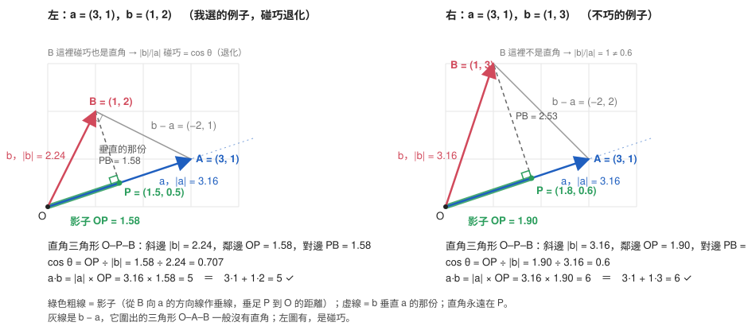
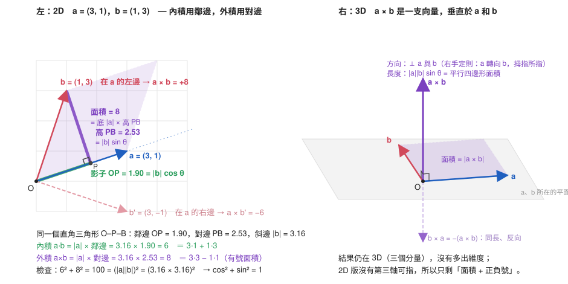
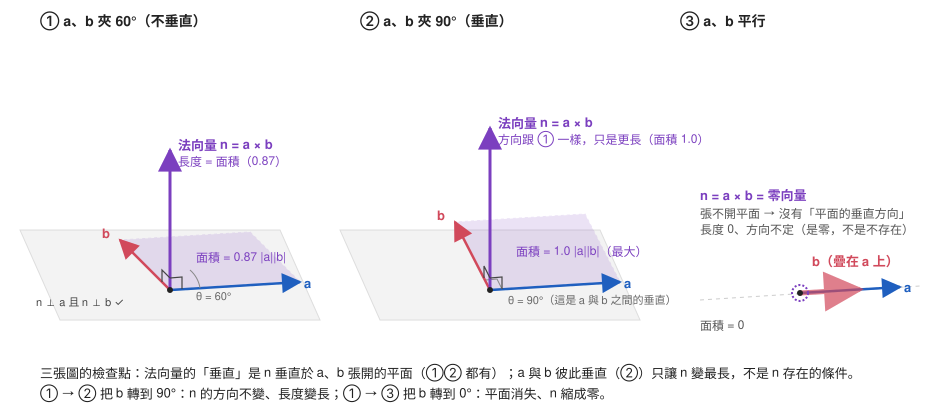
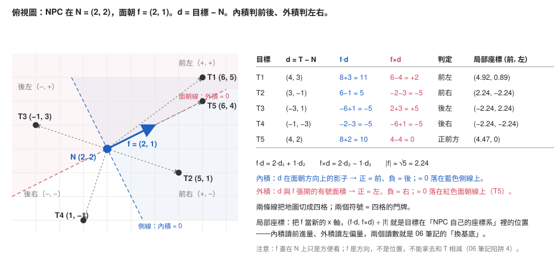
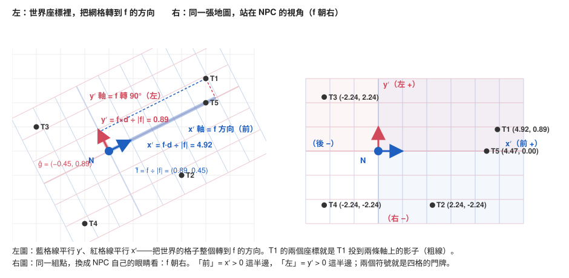

# 向量與矩陣、三種積的分工（Vectors, Matrices & the Three Products）

- 記錄日期：2026-10-09 → 2026-10-15（整理於 2026-10-16）；補強 2026-11-05 → 2026-11-06
- 來源：線索稿來自對話「向量運算與矩陣的關聯」的系統摘要（逐字內容不在本機）；第 3–7 節的從零重建來自對話「向量怎麼做邏輯：推薦系統、向量庫、神經網路」。同一條對話的應用線（embedding、相似度、推薦）另立 10 筆記
- 目前定位：內積、外積、法向量、NPC 局部座標已從零重建並復述（第 3–7 節；✅ 是復述確認過的條目）。矩陣、協方差矩陣、複數乘法 = 旋轉仍只有摘要（第 2 節），維持 🔄
- 附圖：五張 SVG 在 `img/`，放在對應的對照表旁；索引見文末

---

## 0. 一句話版本

**向量「相乘」不是一個運算而是三個：內積量「同向程度」、外積量「張開面積與法向」、複數乘法做「旋轉」；三者在遊戲裡分工為判前後、判左右、轉座標。內積 = 定錨在 a 的方向、取 b 的影子、乘 |a|，量的是「同向共變 × 兩邊大小」；外積拿同一個直角三角形的另一邊；局部座標 = 兩條新軸各做一次內積。**

---

## 1. 概念樹骨架

```
向量（有長度、有方向的一個物件）
 ├─ 分量：同一個向量在某組座標下的投影，不是兩個獨立向量
 │    └─ 分量 = 跟座標軸做內積；內積把「軸」推廣到任何方向（第 5 節）
 ├─ 矩陣：把一組向量排在一起 / 一個把向量送到向量的操作（第 2 節，🔄）
 │    └─ 協方差矩陣：變異數（01 筆記「變異數與標準差」段）往多維推廣
 └─ 「向量乘法」拆成三個
     ├─ 內積：純量；量同向程度；判前後（第 3–5 節從零重建）
     │    ├─ 影子：直角三角形 O–P–B，直角在垂足 P，cos θ = 影子 ÷ 本體
     │    ├─ 為什麼乘不加：「共同」= AND，一邊零則零、一邊翻倍則翻倍、換錨不變
     │    └─ 意義：讀數；換錨點換外衣（座標、功、共變異數、ΔL；相似度 → 10 筆記）
     ├─ 外積：向量（3D）/ 有號面積（2D）；量張開程度與法向，不多出維度；判左右（第 6 節）
     │    ├─ 內積拿鄰邊、外積拿對邊；(a·b)² + (a×b)² = |a|²|b|²
     │    └─ 法向量垂直的是平面，不要求 a ⊥ b；平行時為零，不是不存在
     ├─ 複數乘法：旋轉（05 筆記，複數）= 旋轉矩陣的簡寫（第 2 節，🔄）
     └─ 局部座標：換基底 = 兩條新軸各做一次內積（第 7 節）
          └─ (x′, y′) = (f̂·d, ĝ·d) = (f·d, f×d) ÷ |f|；2D 外積 = 跟 f 轉 90° 的軸做內積
```

嫁接點：
- 協方差矩陣接 01 筆記「變異數與標準差」段；第 5 節再接一次：變異數 = 誤差向量和自己的內積 ÷ n、共變異數 = 兩支誤差向量的內積 ÷ n、相關係數 = 兩支誤差向量的 cos θ（精確等式）。
- 複數乘法接 05 筆記（複數）；「物件 vs 分量」的 type error 與 05 筆記的「軸 vs 分量」同一型。
- 08 筆記「靈敏度表 = 最陡方向」段：ΔL ≈ ∇L·Δw 是內積的又一件外衣。
- 02 筆記「尾巴分類」段的老模式「為零 vs 不存在」：cos = 0 是無關、不是不存在；a ∥ b 時法向量是零向量、不是不存在。
- 往外接：10 筆記（向量當表示）把內積當相似度、推薦當排序，是本篇內積的應用線。

---

## 2. 三種積總覽、矩陣、複數乘法

**種子：問「兩個向量相乘是什麼」之前要先問「要量什麼」——量同向用內積、量張開用外積、要旋轉用複數乘法。**

- 🔄 向量運算與矩陣的關聯：矩陣是把向量操作排成表格；協方差矩陣是變異數的多維版本。
- 🔄 矩陣也是「一次做很多內積」：兩兩相似度表與協方差矩陣同型；神經網路的一層 = 矩陣（線性規則紀錄表）把向量送到向量 + 非線性擠壓（10 筆記）。
- 🔄 三種積的分工：內積 → 純量 → 判前後；外積 → 法向 / 有號面積 → 判左右；複數乘法 → 旋轉。
- 🔄 複數乘法是旋轉矩陣的簡寫表示。

### 對照：三種積一眼分清

內積、外積兩欄在第 3–7 節從零重建；複數乘法欄仍為摘要（🔄）。

| | 內積 | 外積 | 複數乘法 |
|---|---|---|---|
| 結果是什麼 | 純量 | 向量（3D）/ 有號面積（2D） | 複數（一個向量） |
| 量的是 | 同向程度（影子） | 張開程度與法向（高） | 旋轉後的位置 |
| 兩向量平行時 | 最大（同向）/ 最小（反向） | 零 | — |
| 兩向量垂直時 | 零 | 最大 | — |
| 遊戲用途 | 判目標在前還是在後 | 判目標在左還是在右 | 轉座標、轉朝向 |
| 會不會多一個維度 | 否 | 否（3D 結果仍在 3D） | 否 |

> 濃縮：三個積、三種結果型別、三種問題；先問要量什麼，再選積。

---

## 3. 內積從零重建：影子與直角三角形

**種子：內積回答一個問題——「b 有多少成分是沿著 a 的方向」。**

### 定義

```
幾何：a·b = |a| |b| cos θ          θ 為夾角；意義在這裡
代數：a·b = a₁b₁ + a₂b₂ + … + aₙbₙ   直角座標下的記帳方式；高維裡「夾角」反過來由它定義
型別：向量 × 向量 → 純量
```

| 必須滿足的三條 | 式子 | 白話 |
|---|---|---|
| 對稱 | a·b = b·a | 誰投誰都一樣 |
| 可加（線性） | (a + c)·b = a·b + c·b；(ka)·b = k(a·b) | 拆開算再相加、放大幾倍就乘幾倍 |
| 正定 | a·a ≥ 0，= 0 只在零向量 | 自己和自己 = 長度平方 |

### 條目

- ✅ 內積 = |a| × |b| × 一個比例；比例只和夾角有關、不帶長度、落在 [−1, 1]。
- ⚠️ 那個比例**不是**「a 的長度 ÷ 什麼」；a 放大十倍比例不變。比例屬於夾角，不屬於任何一支。
- ✅ 影子（投影）：定錨在 a 的方向，從 b 的箭頭向 a 的方向線作垂線，垂足 P 到 O 的距離 = 影子 = |b| cos θ。cos θ = 影子 ÷ 本體（直角三角形 O–P–B 的鄰邊 ÷ 斜邊）。cos 不是從外面搬來的，它就是「影子佔本體多少」的名字。
- ✅ 內積 = |a| × 影子；這是 a² 的結構把一個因子換成影子，b = a 時退回 |a|²——線索稿時期自己提的「平方就是內積」「和 RMS 很像」在這裡復述確認：向量和自己做內積 = 長度平方，對應 01 筆記「變異數與標準差」段的「平方 → 平均 → 開根號」。
- ⚠️ 直角三角形**整個長在 b 裡面**（斜邊 b、鄰邊影子、對邊垂直剩餘），a 只給方向、a 不是它的邊；用 a、b、a ± b 圍成的三角形一般沒有直角，取「鄰邊 ÷ 斜邊」沒有意義。退化例子裡（a = (3, 1)、b = (1, 2)）那個三角形碰巧有直角，錯規則算出對答案——這是退化例子測不出錯的實例。
- 🔄 為什麼要乘 |a|：單純影子不對稱（b 投到 a ≠ a 投到 b），乘上對方長度後兩邊相等 = |a||b|cos θ，才是「這一對」的性質。
- 🔄 代數面 = 幾何面：分量公式是幾何定義 + 可加性 + 座標軸互相垂直的結果（交叉項為零）；是記帳方式，不是另一個定義。
- ✅ 反向時影子落到背面，cos 負、內積負，180° 最小 = −|a||b|。
- 🔄 內積的刻度是三段：−|a||b|（反向）── 0（無關）── +|a||b|（同向）。0 在中間不在底部；「內積小」要分「接近 0 = 沒關係」與「負 = 有關係但反向」。
- ⚠️ 「cos 值不存在 → 方向根本不同」不對：只要兩支非零，cos 永遠存在；垂直是 cos = 0，不是不存在。唯一沒定義的是零向量（沒有方向）。
- ✅ 夾角小 → cos 大 → 影子比例大 → 內積大（長度固定時）。
- 備註（用詞）：「映射的權重」= 影子比例 cos θ；「累計向量和」→ 是「積」不是「和」，結果是一個數；「等價多少長度 a」→ 影子是沿 a 方向的一段長度，不是「幾個 a」。

### 對照：斜的例子（答案已填）

a = (3, 1)，b = (1, 2)，兩支都不貼座標軸。

| 項目 | 值 | 讀法 |
|---|---|---|
| a·b | 3·1 + 1·2 = 5 | 正 → 夾角小於 90° |
| a·a | 10 | \|a\| = √10 ≈ 3.16 |
| b·b | 5 | \|b\| = √5 ≈ 2.24 |
| 垂足 P | (1.5, 0.5) | 垂線 y = 2 − 3(x − 1) 交 a 的線 y = x/3 |
| b 在 a 上的影子 OP | 5 ÷ 3.16 ≈ 1.58 | 鄰邊 |
| PB（垂直剩餘） | (−0.5, 1.5)，長 1.58 | 對邊；1.58² + 1.58² = 5 = \|b\|² ✓ |
| a 在 b 上的影子 | 5 ÷ 2.24 ≈ 2.24 | ≠ 1.58 → 投影不對稱 |
| cos θ | 1.58 ÷ 2.24 ≈ 0.707 | θ = 45°；兩邊除完長度後相等 → 內積對稱 |

不巧的例子 a = (3, 1)、b = (1, 3)：a·b = 6，cos θ = 0.6，影子 1.90，P = (1.8, 0.6)，PB = 2.53；|b| ÷ |a| = 1 ≠ 0.6，錯規則在這裡壞掉。



### 對照：cos 的存在性（答案已填）

| 夾角 | cos | 讀法 |
|---|---|---|
| 0° | 1 | 同向 |
| 45° | 0.71 | 偏同向 |
| 90° | 0 | 無關（存在，值是零） |
| 135° | −0.71 | 偏反向 |
| 180° | −1 | 反向 |
| 其中一支是零向量 | 不存在 | 沒有方向可比 |

### 對照：同向 vs 靠近（答案已填）

a = (3, 1)。

| b | cos θ | a·b | 距離 \|b − a\| | 同向名次 | 靠近名次 |
|---|---|---|---|---|---|
| (3, 2) | 0.965 | 11 | 1.00 | 2 | 1 |
| (30, 10) | 1.000 | 100 | 28.46 | 1 | 3 |
| (−1, 3) | 0 | 0 | 4.47 | 3 | 2 |
| (0, 0) | 不存在 | 0 | 3.16 | — | — |

同向和靠近的名次顛倒：(30, 10) 最同向卻最遠。零向量那列：內積與距離填得出來，cos 填不出來。

> 濃縮：內積 = 定錨在 a 的方向，b 的影子 × |a|；直角在垂足 P，cos θ = 影子 ÷ |b|；內積還帶著長度，同向與靠近不是同一件事。

---

## 4. 為什麼是乘不是加

**種子：內積要回答的不是「a 和 b 各有多少」，而是「a 和 b 共同有多少」——「共同」天生是乘法。**

- 🔄 轉到同一條線上後相加 = |a| + 影子，那是「a + b 這支新向量在 a 方向上的影子」，講的是一支新向量、不是這一對的關係；a 一大 b 就被淹沒。
- 🔄 「共同」要滿足三件事，加法全部失敗：一邊沒有 → 整個沒有（垂直時乘給 0、加給 |a|）；一邊翻倍 → 共同翻倍（乘翻倍、加不翻）；誰當錨不該有差（|a|·s_b = |b|·s_a；加法換錨答案變）。這三條就是定義表的正定、可加、對稱。
- 🔄 幾何版意義：|a| × 影子 = 長方形面積；物理上 = 功（力 × 沿力方向的位移），這個類比沒有失效處，功本來就是內積。
- 🔄 分量版意義：逐軸「兩邊的量相乘」再加總。每軸是乘不是加，因為這一軸的「共同」要兩邊都有才算：客人動作偏好 3、商品動作成分 0 → 3 × 0 = 0。**乘法是 AND，加法是 OR**；內積 = 逐軸 AND 再加總——「怎麼用向量做邏輯」的一個真正答案：內積裡藏的邏輯是 AND，不是推論（10 筆記）。
- ✅ 取積不取和，是因為要的是關係。
- ⚠️ 「不是大小」不對：a·b = |a||b|cos θ，三個因子裡兩個是大小；純關係是 cos θ，內積是關係再乘兩邊的大小。

### 對照：加與乘（答案已填）

a = (3, 1)，|a| = 3.16。

| 情況 | b | 影子 s | 加：\|a\| + s | 乘：\|a\| × s | 乘的讀法 |
|---|---|---|---|---|---|
| 斜的 | (1, 2) | 1.58 | 4.74 | 5 | 有共同成分 |
| 垂直 | (−1, 3) | 0 | 3.16 | 0 | 完全無關 → 0；加法給 3.16，壞掉 |
| b 放大兩倍 | (2, 4) | 3.16 | 6.32 | 10 | 乘翻倍；加沒翻倍 |
| a 放大兩倍 a′ = (6, 2)、b = (1, 2) | | 1.58 | 7.90 | 10 | 乘翻倍；加幾乎只剩 a 自己 |

### 對照：逐軸 AND（答案已填）

軸：動作、解謎、劇情。客人 u = (3, 1, 2)。

| 商品 | 向量 | 動作 | 解謎 | 劇情 | u·商品 | 排名 |
|---|---|---|---|---|---|---|
| x | (2, 0, 3) | 6 | 0 | 6 | 12 | 1 |
| y | (0, 4, 0) | 0 | 4 | 0 | 4 | 3 |
| z | (1, 1, 1) | 3 | 1 | 2 | 6 | 2 |

y 的解謎成分最高，但排最後：它從動作軸、劇情軸各拿 0 分。

> 濃縮：內積量「共同有多少」；共同是乘不是加——一邊為零就全零、一邊翻倍就翻倍、換錨點不變；逐軸看就是 AND 再加總。

---

## 5. 內積的值是什麼意義

**種子：內積 = 用 a 當尺去量 b，讀出的數。**

- 🔄 內積自己只承諾四件事：正 = 傾向同向、零 = 無關、負 = 傾向反向、絕對值 = 對齊程度 × 兩邊大小。它不說這個數叫什麼，因為它不知道軸是什麼；名字由軸的意義供給（同 01 筆記的 E[X] 要 X 有意義才有名字）。
- 🔄 每件外衣下都在的意義：**讀數**。b 的第 1 分量 b₁ 就是 b·e₁，分量 = 跟座標軸做內積；內積把「軸」從座標軸推廣到任何方向：a·b ÷ |a| = b 在 a 方向上的座標；a 是單位長時 a·b 直接就是座標。第 7 節的局部座標 = 換基底，就是這件事。
- 🔄 統計那件外衣：a、b 是兩個變數的誤差序列時，a·b ÷ n = 共變異數（兩變數同時往同一邊偏的平均量，乘法在這裡的意義是「同時」）；cos θ = 相關係數（Pearson），精確等式；a·a ÷ n = 變異數。推薦系統的「客人與商品相似度」和統計的「兩變數相關」是同一個數。
- 🔄 同一個運算，換錨點就換一件事；六個名字、一個運算（下表）。

| 錨點是誰 | 內積讀成什麼 |
|---|---|
| 另一個商品 | 相似度（10 筆記） |
| 一條有意義的方向 | 座標（讀數） |
| 類別向量 | 分類分數（logit，10 筆記） |
| 誤差序列 | 共變異數 |
| ∇L | 這一步的 ΔL（08 筆記） |
| 力 F | 功 W = F·d |

### 對照：相關係數 = cos θ（答案已填）

三個變數的誤差序列，各四天：X = (3, −1, −1, −1)，Y = (2, 1, −2, −1)，Z = (−1, 2, −2, 1)。|X| = √12 = 3.46，|Y| = |Z| = √10 = 3.16。

| 配對 | 逐天相乘 | 內積 | cos θ（相關係數） | 讀法 |
|---|---|---|---|---|
| X·Y | 6, −1, 2, 1 | 8 | 8 ÷ 10.95 = 0.73 | 大致同向 |
| X·Z | −3, −2, 2, −1 | −4 | −0.37 | 偏反向 |
| Y·Z | −2, 2, 4, −1 | 3 | 0.30 | 弱相關 |
| X·X | 9, 1, 1, 1 | 12 | 1 | 變異數 × 4 |

Z 第 1 天負、X 第 1 天大正 → 這一天對 X·Z 的貢獻是 −3（負）。

> 濃縮：內積 = 用 a 當軸去讀 b 的座標，再乘 |a|；它是「同向共變 × 兩邊大小」，去掉大小就是相關係數；具體叫什麼，由軸的意義決定。

---

## 6. 外積與法向量

**種子：內積用的是 b 的影子（沿 a 的那份），外積用的是 b 的高（垂直 a 的那份）。同一個直角三角形 O–P–B，內積拿鄰邊，外積拿對邊。**

### 定義

```
2D：a × b = |a||b| sin θ = a₁b₂ − a₂b₁                 有號面積：平行四邊形面積 = 底 |a| × 高 |b| sin θ；正負記 b 在 a 的左（+）右（−）
3D：a × b = (a₂b₃ − a₃b₂, a₃b₁ − a₁b₃, a₁b₂ − a₂b₁)      向量：長度 = 面積，方向 ⊥ a、b 張開的平面（右手定則：四指 a 掃向 b，拇指）
      a × b = −(b × a)；a × a = 0；(a·b)² + |a × b|² = |a|²|b|²（cos² + sin² = 1）
```

| 性質 | 內積 | 外積 |
|---|---|---|
| 交換 | a·b = b·a（對稱） | a×b = −b×a（反對稱） |
| 可加 | 兩邊都可加 | 兩邊都可加 |
| 自己和自己 | \|a\|²（最大） | 0（張不開面積） |
| 平行時 | 最大 | 0 |
| 垂直時 | 0 | 最大 = \|a\|\|b\| |
| 量的是 | cos θ（同向程度） | sin θ（張開程度） |

### 條目

- 🔄 2D 版是 3D 版「只看 z 分量」；2D 沒有第三軸可指，所以只剩面積 + 正負號。
- 🔄 結果仍在 3D（三個分量），沒有多出維度（陷阱 3）。
- ⚠️ 「法向量只在 a ⊥ b 時才有」不對：兩個「垂直」是不同的事——a ⊥ b 是輸入之間垂直，只影響面積大小（sin θ = 1 最大）；(a × b) ⊥ a 且 ⊥ b 是輸出垂直於輸入，永遠成立。只要 a、b 不平行就張開一個平面，平面就有法向。唯一沒有的情況：a ∥ b，張不開平面，a × b = 零向量（是零，不是不存在）。
- ⚠️ 「n = a*b 是內積純量」不對：n = a × b 是外積、一支向量；a·b 是內積、一個數。· 和 × 是兩個運算，不是同一個乘號。記號分開用，不要再寫 *。
- ⚠️ 「n 就是面積值」一半對：n 是箭不是數，箭長 = 面積、箭指 = 平面的垂直方向；只拿面積是把箭的長度當成箭本身（物件 vs 物件性質）。
- 類比失效：3D 版「面積」是長度平方，卻被當成一支向量的長度用——記法上的借用，不要問「長度是 8 平方公尺的箭」是什麼。

### 對照：同一個三角形，兩種積（答案已填）

a = (3, 1)，b = (1, 3)，O–P–B：鄰邊 OP = 1.90，對邊 PB = 2.53，斜邊 |b| = 3.16。

| | 算法 | 值 |
|---|---|---|
| 內積 | \|a\| × 鄰邊 = 3.16 × 1.90 | 6 = 3·1 + 1·3 |
| 外積 | \|a\| × 對邊 = 3.16 × 2.53 | 8 = 3·3 − 1·1 |
| 檢查 | 6² + 8² | 100 = (\|a\|\|b\|)² |
| 鏡像 b′ = (3, −1) | 3·(−1) − 1·3 | −6（在 a 的右邊） |



### 對照：法向量存在性（答案已填）

| a、b 夾角 | 平面存在？ | 法向量 | 長度 |
|---|---|---|---|
| 0° 或 180° | 否 | 零向量 | 0 |
| 30° | 是 | 有 | 0.5 \|a\|\|b\| |
| 90° | 是 | 有 | \|a\|\|b\|（最大） |
| 150° | 是 | 有 | 0.5 \|a\|\|b\| |

數字版：a = (2, 1, 0)、b = (1, 3, 0) 都躺在地板上，n = (0, 0, 5)——面積 5 躲在第三格，另兩格記方向。b 抬起一點 b = (1, 3, 1)：n = (1, −2, 5)，長 5.48，箭跟著斜。這例 a·b 也是 5，巧合（2·1 + 1·3 vs 2·3 − 1·1），不要讀成內積 = 面積。



### 對照：外積手填（答案已填）

a = (2, 1)。

| b | a·b | a×b | b 在 a 的哪邊 | (a·b)² + (a×b)² | \|a\|²\|b\|² |
|---|---|---|---|---|---|
| (1, 3) | 5 | 5 | 左 | 50 | 50 |
| (3, −1) | 5 | −5 | 右 | 50 | 50 |
| (4, 2) | 10 | 0 | 在線上（b = 2a，平行） | 100 | 100 |
| (−1, 2) | 0 | 5 | 左（垂直） | 25 | 25 |

> 濃縮：內積拿鄰邊、外積拿對邊；外積 = 張開的面積（2D 帶正負判左右，3D 加法向包成向量）；法向量垂直的是平面，不要求 a ⊥ b；平行時是零不是不存在；· 給純量、× 給向量。

---

## 7. NPC 局部座標：兩條軸各做一次內積

**種子：座標 = 跟軸的單位向量做內積。局部座標只是把 (1, 0)、(0, 1) 換成另外兩支互相垂直的單位向量。**

### 條目

- ✅ 位置與方向都寫成兩個數，型別不同：位置只能相減（得向量）或加上向量（得位置）；內積、外積只對向量做。f = (2, 1) 是方向不是座標點，不能拿去和 N 相減（陷阱 4，這次再撞一次後確認）。
- ⚠️ 把 f 當點去算 f − N：方向 − 位置，型別不對。圖上的藍箭起點 N、尖端 N + f = (4, 3)；硬要用位置相減是 (4, 3) − (2, 2) = f 自己。
- ✅ |f| = √(f·f) = √(2² + 1²) = √5 ≈ 2.24（畢氏定理；「平方就是內積」）。
- 🔄 2D 基底要兩條軸：x′ 沿 f，單位向量 f̂ = f ÷ |f| = (0.894, 0.447)；y′ = f̂ 逆時針轉 90°，ĝ = (−0.447, 0.894)。
- 🔄 x′ = f̂·d = f·d ÷ |f|：座標 = 跟軸的單位向量做內積，除以 |f| 只是把 f 修成單位長。遊戲引擎存單位向量就不用再除。
- 🔄 為什麼叫前後：沒有更深的理由。x′ 軸**定義**成面朝方向，x′ > 0 那半邊**命名**為「前」；「內積正 = 在前」的全部內容是「沿面朝方向的座標是正的」。
- 🔄 y′ = ĝ·d = (f₁d₂ − f₂d₁) ÷ |f| = f×d ÷ |f|：**2D 外積 = 跟「f 轉 90°」的軸做內積**。幾何上一致：面積 ÷ 底 = 高 = d 離面朝線多遠。
- 🔄 為什麼叫左右：也是命名，而且是約定（右手座標系）——逆時針轉 90° 的那條軸叫「左」；當初順時針轉，同一個數就叫「右」。
- 🔄 兩條線（面朝線：外積 = 0；側線：內積 = 0）把地圖切四格；兩個正負號是門牌，兩個數值是 NPC 座標系裡的座標。不是兩個判定，是兩個讀數，判定只是看讀數正負。
- 🔄 點沒動，尺轉了：局部座標圖右邊的 T1–T5 跟左邊同一批點，量它們的網格轉到 f 的方向。仍是直角座標（陷阱 6：不是極座標）。
- ⚠️ 「(a·b ÷ f̂, a×b ÷ f̂)」不對：除的是 |f|（一個數），不能除以向量。正確：(f·d, f×d) ÷ |f| = (f̂·d, ĝ·d)，除以長度或跟單位向量做內積，二選一。
- 備註（用詞）：這題的兩支是 f、d，不是 a、b；「錨點」留給 N（原點），f 是軸。「換成 f 幾點」→ 沿 f 方向走了幾單位長，不是幾個 f。

| 要讀的座標 | 軸的單位向量 | 座標 = 內積 | 換個名字 | 正負號叫什麼 |
|---|---|---|---|---|
| x′ | f̂ = f ÷ \|f\| | f̂·d = f·d ÷ \|f\| | 影子 | + 前、− 後 |
| y′ | ĝ = f̂ 轉 90° | ĝ·d = f×d ÷ \|f\| | 高（面積 ÷ 底） | + 左、− 右 |

### 對照：NPC 視野判定（正負號版）

設 f 是 NPC 面朝方向，d = 目標位置 − NPC 位置。

| 內積 f·d | 外積 f×d（2D 有號） | 目標在 |
|---|---|---|
| > 0 | > 0 | 前方偏左 |
| > 0 | < 0 | 前方偏右 |
| < 0 | > 0 | 後方偏左 |
| < 0 | < 0 | 後方偏右 |
| 任意 | = 0 | 正前或正後（在面朝線上） |

### 對照：NPC 視野（數字版，答案已填）

N = (2, 2)，f = (2, 1)，|f| = 2.24；f·d = 2d₁ + d₂，f×d = 2d₂ − d₁。

| 目標 T | d = T − N | f·d | f×d | 判定 | (x′, y′) = (f·d, f×d) ÷ 2.24 |
|---|---|---|---|---|---|
| T1 (6, 5) | (4, 3) | 11 | +2 | 前左 | (4.92, 0.89) |
| T2 (5, 1) | (3, −1) | 5 | −5 | 前右 | (2.24, −2.24) |
| T3 (−1, 3) | (−3, 1) | −5 | +5 | 後左 | (−2.24, 2.24) |
| T4 (1, −1) | (−1, −3) | −5 | −5 | 後右 | (−2.24, −2.24) |
| T5 (6, 4) | (4, 2) = 2f | 10 | 0 | 正前方（面朝線上） | (4.47, 0) |
| (0, 1) | (−2, −1) = −f | −5 | 0 | 正後方（面朝線上） | (−2.24, 0) |
| (4, 6) | (2, 4) | 8 | +6 | 前左 | (3.58, 2.68) |
| (−2, 0) | (−4, −2) = −2f | −10 | 0 | 正後方（面朝線上） | (−4.47, 0) |



### 對照：兩條路會合（答案已填）

T2 的 d = (3, −1)。

| 算法 | 值 |
|---|---|
| f̂·d = 0.894·3 + 0.447·(−1) | 2.24 |
| f·d ÷ \|f\| = 5 ÷ 2.24 | 2.24 ✓ 相等 |
| ĝ·d = −0.447·3 + 0.894·(−1) | −2.24 |
| f×d ÷ \|f\| = −5 ÷ 2.24 | −2.24 ✓ 相等 |
| (f̂·d)² + (ĝ·d)² | 5 + 5 = 10 = \|d\|² ✓ 兩軸垂直，畢氏在新網格照樣成立 |

T1 用 f̂ 算：0.894·4 + 0.447·3 = 4.92，同 11 ÷ 2.24。



> 濃縮：局部座標 = 兩條新軸各做一次內積；x′ 軸是 f（讀數正負命名為前後），y′ 軸是 f 轉 90°（正負命名為左右）；2D 外積就是跟第二條軸做內積。

---

## 8. 記號

```
a·b  = |a||b| cos θ = Σᵢ aᵢbᵢ          內積：向量進、純量出
a·a  = |a|²                            長度 = √(自己和自己的內積)
proj_a(b) = a·b ÷ |a|                  b 在 a 上的影子
cos θ = a·b ÷ (|a||b|) ∈ [−1, 1]        同向程度 / 相關係數
|a − b|² = |a|² + |b|² − 2 a·b          距離與內積的換算
a×b（2D）= |a||b| sin θ = a₁b₂ − a₂b₁   有號面積
a×b（3D）= 向量，|a×b| = |a||b| sin θ    法向量
(a·b)² + |a×b|² = |a|²|b|²
f̂ = f ÷ |f|                            戴帽 = 單位向量（方向不變、長度修成 1）；念「f hat」
ĝ = f̂ 轉 90°（有些書寫 f⊥）             左軸
(x′, y′) = (f̂·d, ĝ·d) = (f·d, f×d) ÷ |f|   局部座標；撇號 = 新軸上讀到的數
W = F·d                                功
```

- 🔄 記號慣例：帽子給向量（單位向量）、撇號給新座標系裡的讀數、· 內積、× 外積，不混用 *。
- ⚠️ 「hat = 多少個單位、X per p」一半對：f̂ 的確是一把尺（對 d 做內積讀出「沿這方向幾個單位長」），但帽子只給向量、只管方向，「單位」指長度 1 不是物理單位；「每 p 多少 X」是率（08 筆記「單位分析」段），跟帽子無關。
- 🔄 撞名：統計裡 p̂、μ̂、σ̂ 的帽子是「估計值」，與單位向量無關；底下是向量 → 單位向量，底下是參數 → 估計值。

---

## 陷阱清單

1–6 是線索稿時期摘要列為「需要修正的概念混淆」的；7–14 是補強那條線上實際撞到的。

1. ❌ 把「向量乘法」當成單一運算 → ✅ 至少有三種不同的積，結果型別都不同 → 為什麼：問「兩個向量相乘是什麼」之前要先問「要量什麼」。
2. ❌ 內積結果是純量，所以「與方向無關」 → ✅ 內積的值完全由兩向量的夾角決定，只是結果不帶方向 → 為什麼：「結果沒有方向」與「輸入的方向不重要」是兩件事；物件 vs 物件性質的 type error。
3. ❌ 外積會「多出一個維度」 → ✅ 3D 外積的結果仍是 3D 向量，只是垂直於原本兩個；2D 版是有號面積 → 為什麼：「垂直於兩者」被誤讀成「跳到更高維」。
4. ❌ 把 NPC 的面朝方向當成位置去做減法 → ✅ 方向是方向、位置是位置；相減只對位置（得到位移）有意義 → 為什麼：又是 type error，兩個東西剛好都是「兩個數」但型別不同。補強時再撞一次（算 f − N 當「變量」），復述後確認：型別看「從哪來、能做什麼」，不看寫成幾個數（第 7 節）。
5. ❌ 複數的實部與虛部是兩個獨立向量 → ✅ 它們是同一個向量在實軸、虛軸上的兩個分量 → 為什麼：與 05 筆記（複數）的「軸 vs 分量」同型；一個物件不會因為被拆成分量就變成兩個物件。
6. ❌ 局部座標 = 極座標 → ✅ 局部座標是換一組基底（仍是直角座標，只是 x 軸對準面朝方向）；極座標是換成（長度、角度）這組參數 → 為什麼：「以某方向為準」和「用角度表示」是兩個不同的改寫。
7. ❌ cos θ 是「a 的長度 ÷ a + b 的長度」（或 |b| ÷ |a|） → ✅ cos θ = 影子 ÷ |b|，直角三角形 O–P–B 整個長在 b 裡，a 只給方向 → 為什麼：用 a、b、a ± b 圍的三角形一般沒有直角；退化例子（a = (3, 1)、b = (1, 2)）裡碰巧有，錯規則算出對答案（第 3 節）。
8. ❌ 取積不取和是「要關係不要大小」 → ✅ 要的是關係，但內積 = 關係 × 兩邊大小；純關係是 cos θ → 為什麼：三個因子裡兩個是長度（第 4 節）。
9. ❌ cos 值「不存在」表示方向根本不同 → ✅ 兩支非零向量 cos 永遠存在，垂直是 0 → 為什麼：「為零」和「不存在」是兩個類別（同 02 筆記尾巴分類的老模式）；只有零向量沒有夾角（第 3 節）。
10. ❌ 法向量只在 a ⊥ b 時才有 → ✅ 只要 a、b 不平行就有；a ⊥ b 只讓它最長 → 為什麼：法向量的「垂直」是對平面說的，不是對 a、b 之間說的；兩個「垂直」是輸入之間 vs 輸出對輸入（第 6 節）。
11. ❌ n = a*b 是內積純量 → ✅ n = a × b 是外積、一支向量 → 為什麼：· 和 × 是兩個運算；陷阱 1 又冒出來（第 6 節）。
12. ❌ n 就是面積值 → ✅ n 是箭：箭長 = 面積，箭指 = 平面的法向 → 為什麼：物件 vs 物件性質（第 6 節）。
13. ❌ 局部座標 = (a·b ÷ f̂, a×b ÷ f̂) → ✅ (f·d, f×d) ÷ |f| = (f̂·d, ĝ·d) → 為什麼：不能除以向量；f̂ 是拿來做內積的，不是除數（第 7 節）。
14. ❌ hat = 「X per p」那種單位 → ✅ 帽子 = 單位向量（長度 1 的方向） → 為什麼：帽子只給向量，「每 p 多少 X」是率（第 8 節）。

備註（用詞，不記 ⚠️）：「累計向量和」→ 積；「等價多少長度 a」→ 沿 a 方向的長度；「映射的權重」→ cos θ；「錨點」留給 N、f 是軸；「f 幾點」→ 沿 f 幾單位長。

### 弱點模式再次出現

- 傾向用**退化案例**測試（方向剛好對齊座標軸、或三角形碰巧有直角），這時內積、外積、分量的差別看不出來，錯規則也算出對答案 → 測試要刻意選斜的向量（同 05 筆記的教訓：拿實部虛部都非零的例子）；a = (3, 1)、b = (1, 2) 碰巧直角，換成 b = (1, 3) 錯規則就壞。
- **物件 vs 其性質**、**物件 vs 其分量**、**位置 vs 方向**、**為零 vs 不存在**的 type error，不是算術錯誤。

---

## 心智模型總結

```
向量     ← 一個物件；分量是它的投影（= 跟軸做內積），不是另一個向量
矩陣     ← 向量操作的表格 = 一次做很多內積；協方差矩陣 = 多維變異數
內積     ← 定錨在 a 的方向，取 b 的影子，乘 |a|；= 同向共變 × 兩邊大小；逐軸 AND 再加總；判前後
cos θ    ← 影子 ÷ 本體；純關係 = 相關係數；0 是無關不是不存在
刻度     ← −|a||b|（反向）── 0（無關）── +|a||b|（同向）；內積大 = 近，距離小 = 近
外積     ← 同一個三角形的對邊 × |a| = 面積；2D 帶正負判左右；3D 加法向包成箭；不多維
法向量   ← 垂直的是平面，不要求 a ⊥ b；平行時是零
複數乘法 ← 旋轉 = 旋轉矩陣簡寫；轉座標
局部座標 ← 兩條單位軸各做一次內積：(f̂·d, ĝ·d)；2D 外積 = 跟 f 轉 90° 的軸做內積；不是極座標
型別     ← 位置 vs 方向；向量 vs 純量；物件 vs 性質；為零 vs 不存在
測試     ← 向量要選斜的，對齊座標軸或碰巧直角的例子測不出差別
```

---

## 附圖索引

| 檔案 | 內容 | 放在 |
|---|---|---|
| `img/inner-product-projection.svg` | 影子與直角三角形 O–P–B；左圖退化例子（碰巧直角）、右圖不巧例子 | 第 3 節 |
| `img/cross-product.svg` | 同一個三角形：內積拿鄰邊、外積拿對邊；3D 法向量 | 第 6 節 |
| `img/normal-vector.svg` | 法向量三格：夾 60°、夾 90°、平行 | 第 6 節 |
| `img/npc-field-of-view.svg` | NPC 俯視圖：面朝線與側線切四格，五個目標的內積、外積、局部座標 | 第 7 節 |
| `img/local-coordinates.svg` | 局部座標：網格轉到 f 的方向 vs NPC 視角 | 第 7 節 |
