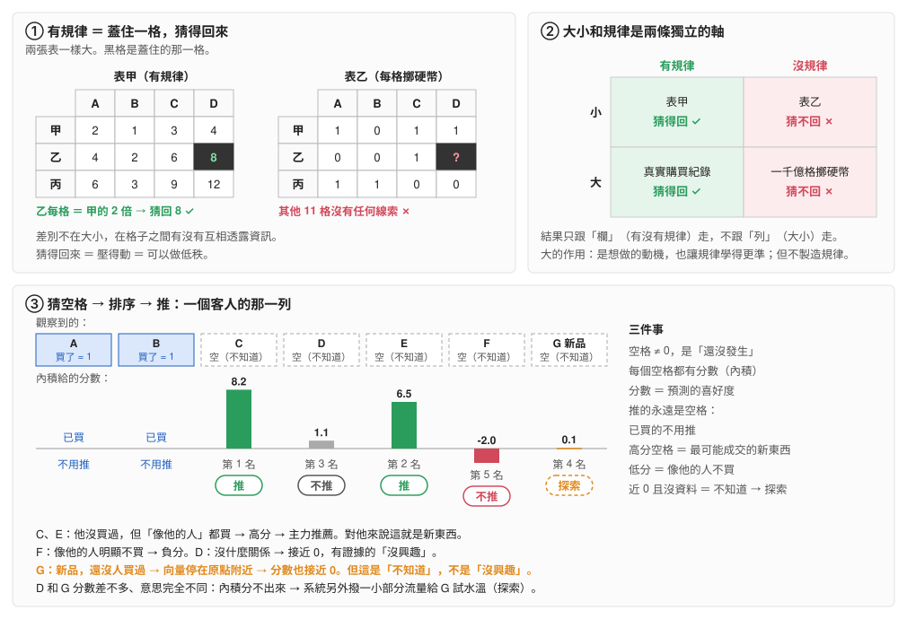
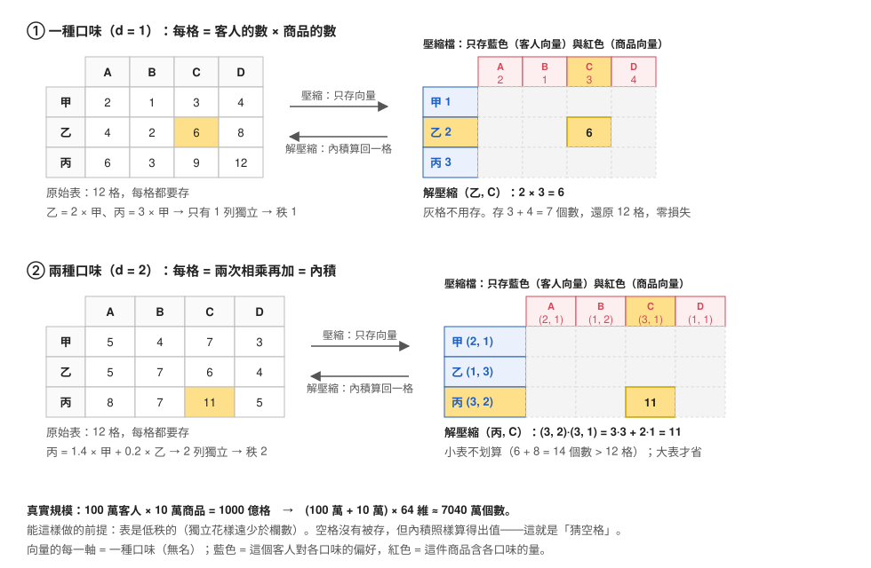
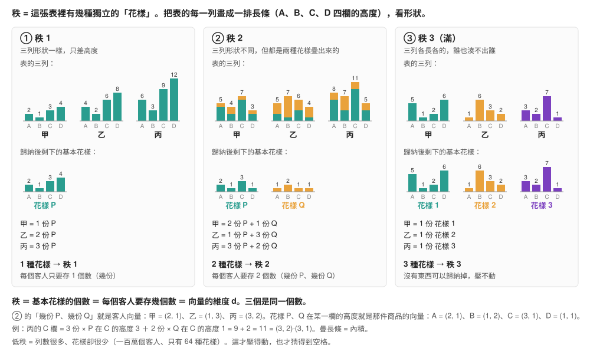
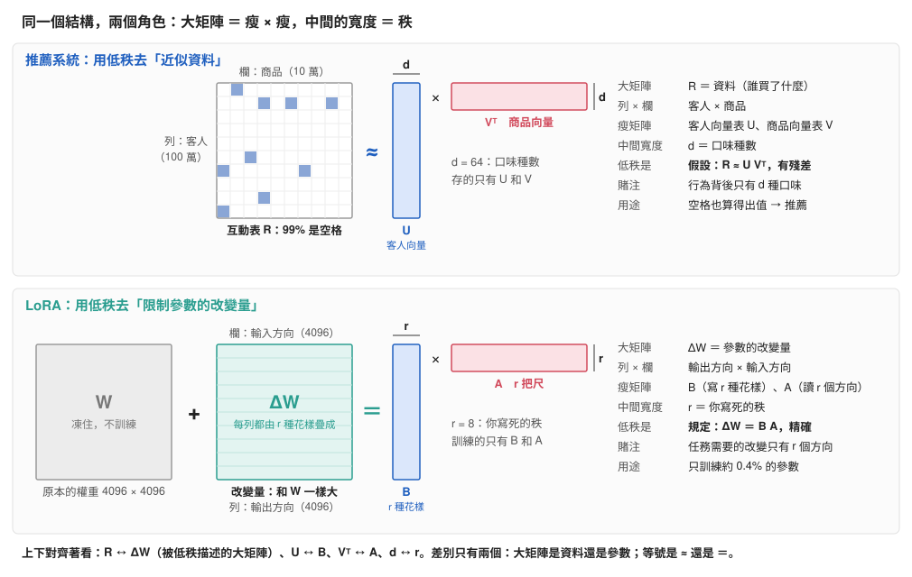

# 推薦空間怎麼來：低秩、矩陣分解與訓練（Low Rank, Matrix Factorization & Training）

- 來源：對話「向量怎麼做邏輯：推薦系統、向量庫、神經網路」的後半（起因：對向量有一定領悟後，想知道推薦系統的設計概念——向量空間怎麼定義出來、每個點的意義、向量到底怎麼訓練出來；中途接上自己做 LoRA 時看到的 rank）
- 目前定位：應用線，接 10 筆記往下挖：10 筆記講「有了向量之後怎麼用」，本篇講「向量與空間從哪來」。attention 與反向傳播仍未開。
- 附圖：四張 SVG 在 `img/`，放在對應的對照表旁；索引見文末
- 補強：第 2、3、6、7 節各一則、第 4、8 節各兩則 `> **補強**` 是入庫時加的，不是這條線上的導師內容；沒有經過復述確認，不帶狀態標記。

---

## 0. 一句話版本

**推薦空間不是定義出來的，是把一張幾乎全空的「客人 × 商品」表寫成兩張向量表相乘、用損失推拉出來的；能這樣做的前提是行為有規律（低秩），不是表很大；秩 = 疊出所有列最少要幾種花樣；每個空格的內積就是預測喜好度，排序後推前幾名；LoRA 是同一個「大矩陣 = 瘦 × 瘦」結構，只是拿去限制參數的改變量。**

---

## 1. 概念樹骨架

```
互動表 R（客人 × 商品，99% 空格）
 ├─ 表不會猜空格：每格獨立，只能查
 │    └─ 規定每格 = u·v → 所有格子共用同一批數字 → 空格自動有值      ← 10 筆記「向量當表示」段
 │         └─ 列本來就是向量（長而稀疏、只認「相同」）→ 壓成短而稠密（認得「相似」）
 │                                                                  ← 06 筆記「為什麼是乘不是加」段（逐軸 AND）
 ├─ 為什麼能壓縮：有規律 = 蓋住一格猜得回來（不是因為大）
 │    ├─ 壓縮 = 預測；壓不掉的 = 猜不到的                            ← 09 筆記「交叉熵：牆」段（地板 = 熵）
 │    └─ d 種口味逐一相乘再加總 = 內積：向量是假設本身
 ├─ 秩 = 疊出所有列最少要幾種花樣 = 完整還原最少要幾維
 │    ├─ 秩是表的性質；d 是你選的
 │    └─ 實務的低秩 = 花樣強度掉得快（假設、近似），不是精確的秩很小   ← 02 筆記「尾巴分類」段
 ├─ LoRA：ΔW = B × A，同一個結構
 │    ├─ 大矩陣是參數的改變量，不是資料；低秩是規定（＝），不是假設（≈）
 │    └─ A = r 把尺（讀）、B = r 種花樣（寫）；改變只活在 r 個方向的子空間  ← 06 筆記「內積的值是什麼意義」段（讀數）
 ├─ 猜空格 → 排序 → 推
 │    ├─ 空格 = 不知道，不是 0；每個空格都有分數 = 預測喜好度
 │    └─ 只推高分 → 新品永遠出不來 → 探索「不確定的」≠ 推低分          ← 07 筆記（指標不是目標）
 └─ 怎麼訓練：Δu = −η e v、Δv = −η e u                                ← 08 筆記「一步」段、09 筆記「底在哪：拉力規則」段
      ├─ 預測太低拉近、太高推開；負樣本提供推開的力
      └─ raw log → （客人, 商品, 值）→ 損失 → 梯度 → 兩張向量表 = 權重    ← 08 筆記「點與地形」段
```

嫁接點：
- 10 筆記「向量當表示（embedding）」段「向量從哪來：embedding 表本身就是 w」：本篇第 8 節是那一條的機械版本。
- 10 筆記「內積 → 相似度 → 推薦」段「什麼叫近是損失定義的」：本篇第 2 節列出三把尺。
- 06 筆記「為什麼是乘不是加」段：原始列的內積 = 共同買過幾件（逐軸 AND），只認「相同」。
- 06 筆記「內積的值是什麼意義」段：A 的每一列是一把尺，對輸入做內積讀出一個數。
- 08 筆記「偏微分與梯度」段：釘住其他、只動 u₁，內積變 v₁ → 內積對 u 的靈敏度表就是 v。
- 08 筆記「過擬合」段：資料 = 機制 + 雜訊；d 是「留多少當機制」的旋鈕。
- 09 筆記「底在哪：拉力規則」段：每支向量停在它所有格子的拉力抵銷之處。
- 02 筆記「假設檢定」段：驗證集要按時間切，探索過的資料不能再驗證。
- 05 筆記（複數）：旋轉保長度保夾角 → 內積對旋轉不變 → 座標軸釘不住。
- 01 筆記「變異數與標準差」段：均值留一個數、變異數是丟掉的量；低秩留 d 種花樣，後面花樣強度² 的和是丟掉的量。

---

## 2. 推薦空間的設計：一張全空的表

**種子：推薦系統的原始資料是一張巨大、幾乎全空的表——列是客人、欄是商品、格子是「有沒有互動」。整個設計只做一件事：用向量把空格填起來。**

- ✅ 原始資料就是一張二維的表：列 = 客人、欄 = 商品、格子 = 互動。
- ⚠️ 「因為這兩個數很大，所以要轉向量」不對：大是次要理由。真正的理由是**表不會猜空格**——每格獨立，知道「甲買了 A」對「甲會不會買 D」沒有資訊；4 × 4 只要有空格問題就在，一千億格全填滿就直接查表、不需要向量。關鍵不是大，是空。
- 🔄 向量做的事：規定每格 = u·v，讓所有格子共用同一批數字。甲的向量同時要解釋 A、B 兩格，D 的向量同時要解釋買過它的所有人，於是「甲 × D」這個沒人填過的空格自動有值。猜空格的能力來自共用；壓縮（d 遠小於欄數）只是逼它們非共用不可。
- 🔄 表的每一列本來就是一支向量（十萬維、幾乎全零、每軸 = 一件具體商品）。所以不是「表 → 向量」，是「長而稀疏 → 短而稠密」。原始列的內積 = 共同買過幾件，只認「完全同一件」；壓縮後才認得「相似」。
- 🔄 空間不是定義的，是訓練出來的。設計者只決定：誰有向量、d 多少、損失是什麼、負樣本怎麼抽、偏差項拆不拆、向量怎麼產。沒有人畫過座標軸。
- 🔄 座標軸無名有邏輯理由：內積對旋轉不變（所有向量一起轉，每一對內積都不變），損失看不出空間轉了沒，訓練不可能把軸釘住。10 筆記「座標軸沒有名字」那條的原因在此。
- 🔄 損失定義「近」：預測評分（碗）→ 近 = 會給高分；下一件買什麼（softmax + 牆）→ 近 = 接下來會買；成對排序 → 近 = 排名在前。同一張表、三把尺、三個不同的空間。
- 🔄 推開比拉近重要：只說「買過的要近」有作弊解——全部向量疊成一支。每把尺都必須含「沒買的要遠」（負樣本，negative sampling）。高維裡無關的向量幾乎垂直，是負樣本推出來的。
- 🔄 長度 = 熱門度：人人都買的商品向量會很長。多數系統拆出偏差項（bias）：分數 = u·v + b_商品 + b_客人。
- 🔄 三代演進，骨架不變（兩種物件、同一空間、內積、取前 k）：矩陣分解（查表）→ 雙塔（two-tower，商品向量由特徵算出，解冷啟動）→ 序列模型（客人向量由購買歷史算出）。
- 備註（用詞）：表的「二維」= 兩個索引；向量的「d 維」= 每個物件有 d 個數，兩個「維」不是同一件事。列數、欄數是資料大小，不是參數；參數是向量的座標，共（客人數 + 商品數）× d 個。

### 對照：每個點的意義

| 物件 | 點是什麼 | 怎麼到那裡 |
|---|---|---|
| 一個商品 v | 「買它的人長什麼樣」的壓縮摘要 | 被買過它的客人向量拉近、沒買的推開 |
| 一個客人 u | 「他買的東西長什麼樣」的壓縮摘要 | 被他買過的商品向量拉近 |
| u·v | 預測這格是 1 的傾向 | 由上兩者決定 |
| 原點 | 對誰都沒傾向 | 沒有互動的新客人、新商品停在這附近 |
| 一條方向 | 一種口味 | 事後拿尺去量才讀得出，模型沒標 |

客人和商品住在同一個空間是設計核心：兩種不同型別的東西放進同一空間，內積才能跨型別比較。兩者互相定義，由訓練同時解開。

### 對照：原始列只認「相同」（答案已填）

商品 A、B、C、D；甲 = (1, 1, 0, 0)、乙 = (1, 0, 1, 0)、丙 = (0, 0, 1, 1)。

| 配對 | 原始內積（共同買過幾件） | 原始表的判定 |
|---|---|---|
| 甲·乙 | 1 | 有關（共同買 A） |
| 乙·丙 | 1 | 有關（共同買 C） |
| 甲·丙 | 0 | 無關 |

甲、丙被判無關；「乙同時買了 A 和 C」這個資訊在原始內積裡完全沒用到。壓縮後 A、C 因為被同一個人買而靠近，甲、丙才跟著靠近。

### 對照：d = 2 的迷你矩陣分解（答案已填）

商品 A = (2, 0.5)、B = (1.5, 1)、C = (0.5, 2)、D = (1, 1.5)；甲 = (1.5, 0.5)、乙 = (0.5, 1.5)。甲買過 A、B；乙買過 C。

| | A | B | C | D | 推薦誰 |
|---|---|---|---|---|---|
| 甲 u·v | 3.25 | 2.75 | 1.75 | 2.25 | D（空格裡最高） |
| 甲 實際 | 1 | 1 | 空 | 空 | |
| 乙 u·v | 1.75 | 2.25 | 3.25 | 2.75 | D（空格裡最高） |
| 乙 實際 | 空 | 空 | 1 | 空 | |

已知格子的預測各是該列最高；兩人都推 D，因為 D 兩種口味都有、坐在中間。把六支向量一起轉 90°，這張表一格都不變。

> **補強**（入庫時加，非這條線的導師內容）：不變的不只旋轉。把所有客人向量的第 1 軸乘 2、所有商品向量的第 1 軸除以 2（一邊拉長、另一邊對應壓短），上表同樣一格都不變，但同一張表**內部**的內積會變：
>
> | | 拉伸前 | 拉伸後 |
> |---|---|---|
> | 甲、A 的向量 | (1.5, 0.5)、(2, 0.5) | (3, 0.5)、(1, 0.5) |
> | 甲·A（預測） | 3.25 | 3.25 |
> | A·B、A·D、A·C（商品像不像） | 3.5、2.75、2 | 1.25、1.25、1.25 |
> | 六支向量長度² 的總和 | 20 | 21.875 |
>
> 損失只看得到跨表的 u·v，所以它釘住的只有預測。「商品像不像」（v·v′）、「客人像不像」（u·u′）和長度都不是損失直接決定的：旋轉保住它們，拉伸不保——拉伸前 A 最像 B，拉伸後 B、D、C 分不出來。實務上把它們定下來的是另一股力：正則化（第 8 節的補強）偏好總長度小的那一組，把拉伸的自由度收掉，大致只剩旋轉。所以第 8 節「v·v′ 商品像不像」和本節「長度 = 熱門度」讀的是「損失 ＋ 正則化」一起定下來的空間，不是損失單獨定的。

> 濃縮：資料是一張二維的表，但表不會猜空格；向量讓所有格子共用同一批數字，空格才有值。空間是訓練出來的，點 = 壓縮摘要，軸無名，「近」由損失和負樣本決定，長度是熱門度。

---

## 3. 為什麼能壓縮：有規律

**種子：有規律 = 蓋住一格，能從其他格子把它猜回來。能壓縮 = 格子之間不獨立。**

- 🔄 兩個極端：完全有規律（每格 = 客人的一個數 × 商品的一個數）→ 只要（客人數 + 商品數）個數就完整重建；完全沒規律（每格擲硬幣）→ 一格都壓不掉，也猜不了。
- 🔄 壓縮和預測是同一件事：能壓縮 ⇔ 格子互相透露資訊 ⇔ 從已知格推得出未知格。「為什麼可以壓縮」和「為什麼可以推薦」答案相同：人的行為不是擲硬幣。
- ⚠️ 「之所以可以做低秩，是因為數據過於龐大」不對（這條線上撞了兩次）：大小和規律是兩條獨立的軸。大是**想做的動機**（小表直接查），也讓規律學得更準（01 筆記「大數法則 vs 中央極限定理」段）；但大不製造規律。
- 🔄 放到人身上：有規律 = 知道你買過什麼，就大致猜得到你沒買過的東西裡你會要哪些——人會成群。
- 🔄 壓縮的形式為什麼剛好是內積：d 種口味時，格子 = Σ（客人對口味 k 的偏好 × 商品含口味 k 的量）= u·v。「世界有 d 種口味」和「格子 = 兩支 d 維向量的內積」是同一句話；向量不是外加的技巧，是假設本身。那些看不見的口味叫潛在因子（latent factor）。
- ⚠️ 「壓縮的答案是內積」層級放錯：內積本身不是壓縮，它只還原**一格**。壓縮檔是兩張向量表（整張表的事），內積是解壓縮公式（一格的事）。
- 🔄 「丟掉的是雜訊」是賭注，不是定理（這是被追問後修正的）。「留前 d 種花樣是平方誤差最小的壓法」是定理；「丟掉的那部分是雜訊」只能用驗證集檢驗：蓋住一些已知格子，丟掉後猜得更準，才叫它雜訊。雜訊的操作定義 = 不能推廣到沒看過的格子的部分。
- 🔄 名稱：把大表寫成兩張瘦表相乘 = 矩陣分解（matrix factorization）；強調秩小 = 低秩近似（low-rank approximation）；用在推薦上整個做法 = 協同過濾（collaborative filtering）；數學上最佳的那種 = 截斷 SVD。

> **補強**（入庫時加，非這條線的導師內容）：「留前 d 種花樣是平方誤差最小的壓法」（Eckart–Young 定理）和「數學上最佳 = 截斷 SVD」講的都是**每一格都有值的表**。推薦的表 99% 是空格，定理的前提不成立：SVD 需要每一格的值。把空格填 0 再分解做得出來，但那是把 99% 的空格當成跟已知格子一樣可信的觀察值「0」去還原（第 7 節的種子：空格是不知道，不是 0），是另一個問題的最佳解。所以實際做法是第 8 節那樣**只對已知格子算誤差**；這個版本沒有現成的最佳解公式，只能用梯度一步步推。連帶第 5 節的還原曲線也量不到：花樣強度是填滿的表才有的讀數，有空格時 d 選多少只能看驗證集（蓋住的已知格子猜得準不準），不是看曲線的膝蓋。

### 對照：一樣大的兩張表（答案已填）

| 表甲 | A | B | C | D | | 表乙 | A | B | C | D |
|---|---|---|---|---|---|---|---|---|---|---|
| 甲 | 2 | 1 | 3 | 4 | | 甲 | 1 | 0 | 1 | 1 |
| 乙 | 4 | 2 | 6 | **8** | | 乙 | 0 | 0 | 1 | **?** |
| 丙 | 6 | 3 | 9 | 12 | | 丙 | 1 | 1 | 0 | 0 |

表甲蓋住的那格：乙每格是甲的兩倍 → 8，猜得回。表乙（每格擲硬幣）：其他十一格沒有任何線索，猜不回。表甲 12 格只要 3 + 4 = 7 個數就能完整描述，秩 1。

### 對照：大小 × 規律

| | 有規律 | 沒規律 |
|---|---|---|
| **小** | 表甲：壓得動、猜得到 | 表乙：壓不動、猜不到 |
| **大** | 真實購買紀錄：壓得動、猜得到 | 一千億格擲硬幣：壓不動、猜不到 |

結果只跟欄走，不跟列走。



### 對照：壓縮檔 vs 解壓縮公式

| 東西 | 是什麼 | 層級 |
|---|---|---|
| 壓縮檔 | 兩張向量表（每個客人一支、每件商品一支） | 整張表 |
| 解壓縮公式 | 內積：要哪一格，就拿那個客人和那件商品的向量算一次 | 一格 |



誠實備註：3 × 4 的小表用 d = 2 要存 14 個數，比 12 格還多；一百萬 × 十萬的表用 d = 64，一千億格 → 約 7040 萬個數。

> 濃縮：有規律 = 蓋住一格猜得回來，跟表多大無關；壓縮 = 預測，壓不掉的 = 猜不到的；壓縮檔是向量，內積是把一格算回來的公式；「丟掉的是雜訊」是賭注，用蓋住的格子檢驗。

---

## 4. 秩：幾種獨立的花樣

**種子：把表的每一列畫成一排長條。秩 = 要幾種基本形狀，才疊得出所有的列。**

- ✅ 秩 ≈「能不能再歸納」：一列能由別的列「縮放後相加」湊出來，它就是多餘的，可以歸納掉；歸納到不能再歸納時剩幾列，就是秩。
- 備註（用詞）：秩是一個數；低秩是形容詞（這個數很小）。「無法歸納的那一層就是低秩」把數和形容詞混了。
- 🔄 秩 1：所有列形狀一樣、只差高度 → 記一個形狀 + 每人幾份。秩 2：形狀各不相同，但都是兩種花樣按不同配方疊出來。滿秩：各長各的，誰也疊不出誰，沒得省。
- 🔄 配方（幾份 P、幾份 Q）= 客人向量；花樣 P、Q 在某一欄的高度 = 那件商品的向量；把一根長條疊出來 = 內積。
- ✅ 秩就是「需要幾維」：秩 = 完整還原這張表最少需要幾維。
- 🔄 秩和 d 是同一種數，但屬於不同的東西：秩是表（資料）的性質，只能去量；d 是模型的設定，你選的。d = 秩 → 零損失；d < 秩 → 有損近似；d > 秩 → 多的維度沒事做或去背雜訊（08 筆記「過擬合」段）。推薦系統永遠是 d < 秩。
- 類比失效：長條的「形狀」只在欄的順序固定時看得出來；十萬欄沒人看得出形狀，但「幾種原料疊出所有列」照樣成立——秩是數出來的，不是看出來的。

> **補強**（入庫時加，非這條線的導師內容）：秩 1 的表沒有個人化。每格 = 客人的一個數 × 商品的一個數時，每個客人對商品的排序都相同（第 3 節的表甲：甲、乙、丙都是 D > C > A > B），客人的那個數只決定整列放大幾倍，推出來是同一份排行榜。（客人的數若是負的，排序整個反過來，仍然只有一份榜單。）真實互動表最強的那種花樣通常就是「活躍度 × 熱門度」，和第 2 節的偏差項處理的是同一件事，只是那邊用加的、這裡用乘的；「這個人跟別人哪裡不一樣」從第 2 種花樣才開始。所以純 u·v（不拆偏差項）、d = 1 的系統對所有人推一樣的東西。



### 對照：數秩（答案已填）

| 表 | 第 1 列 | 第 2 列 | 第 3 列 | 哪一列能由別列湊出 | 秩 |
|---|---|---|---|---|---|
| 一 | (2, 1, 3) | (4, 2, 6) | (6, 3, 9) | 第 2 列 = 2 × 第 1 列；第 3 列 = 3 × 第 1 列 | 1 |
| 二 | (2, 1, 3) | (1, 2, 1) | (3, 3, 4) | 第 3 列 = 第 1 列 + 第 2 列 | 2 |
| 三 | (2, 1, 3) | (1, 2, 1) | (1, 1, 2) | 都湊不出 | 3 |

> **補強**（入庫時加，非這條線的導師內容）：橫著數和直著數是同一個數。上表數的是「幾種花樣疊得出所有的**列**」；改數「幾種花樣疊得出所有的**欄**」，答案永遠一樣（列秩 = 欄秩，row rank = column rank）。表二橫著是第 3 列 = 第 1 列 + 第 2 列；直著看，三欄是 (2, 1, 3)、(1, 2, 3)、(3, 1, 4)，第 3 欄 = 5/3 × 第 1 欄 − 1/3 × 第 2 欄，也是 2。這就是客人向量和商品向量共用同一個 d 的原因：不存在「客人要 3 維、商品只要 2 維」的表。順帶一個類比失效：配方的「份數」可以是分數、可以是負的，長條圖畫的「疊幾份」只是正整數的特例。

### 對照：配方（答案已填）

P = (2, 1, 3, 1)、Q = (1, 2, 1, 1)。

| 列 | A | B | C | D | 配方 |
|---|---|---|---|---|---|
| 甲 | 5 | 4 | 7 | 3 | 2 份 P + 1 份 Q |
| 乙 | 5 | 7 | 6 | 4 | 1 份 P + 3 份 Q |
| 丙 | 8 | 7 | 11 | 5 | 3 份 P + 2 份 Q |
| 丁 | 4 | 5 | 5 | 3 | 1 份 P + 2 份 Q |
| 戊 | 6 | 3 | 9 | 3 | 3 份 P + 0 份 Q |
| 己 | 3 | 3 | 3 | 3 | 疊不出來（A、B 兩欄逼出 1 份 P + 1 份 Q，但那樣 C 欄是 4 不是 3） |

己加進表裡，秩從 2 變 3。丙的 C 欄 = 3 × 3 + 2 × 1 = 11 = (3, 2)·(3, 1)：疊長條 = 內積。

> 濃縮：秩 = 疊出所有列最少要幾種基本形狀 = 完整還原最少要幾維；配方是客人向量、形狀在各欄的高度是商品向量；秩是表的性質，d 是你選的。

---

## 5. 低秩是假設：花樣有強度

**種子：花樣有大小。精確的秩數「有幾個花樣不為零」；實務的低秩數「有幾個花樣夠大」。前者是事實，後者是判斷。**

- ✅ 「低秩聽起來像一種估測值」——抓對了：實務上的低秩就是估測。
- 🔄 花樣可以按強度由大排到小（正式名字是奇異值，singular value；怎麼算是計算技術，沒有不算的捷徑）。
- 🔄 精確的秩太脆：乾淨的秩 2 表，強度 (10, 4, 0, 0)；每格加一點雜訊變 (10, 4, 0.3, 0.2)，精確的秩立刻從 2 跳到 4。「為零」這個條件一粒雜訊就打破，所以真實資料的精確秩永遠是滿的，沒有資訊量。這是「為零 vs 不存在」的鄰居：「為零 vs 很小」。
- 🔄 實務換一個問題：留前 d 個花樣能還原多少。這是一條曲線；「這張表是低秩的」= 曲線很快就平。切在哪是你的決定。
- 🔄 低秩是對資料的假設：強度掉得快、後面一長串都很小（尾巴輕，02 筆記「尾巴分類」段）。有的表曲線陡，有的緩降沒有膝蓋——後者 d 選多少都丟很多。
- 🔄 代價：強度小不保證是雜訊，小眾但真實的偏好也在尾巴裡，會被一起抹平。
- 類比與失效：MP3 丟掉弱的頻率。MP3 丟的是「人耳聽不到的」，有生理依據；推薦系統丟的是「強度小的」，沒有這種保證。

### 對照：兩條還原曲線（答案已填）

| d | 陡的表：強度² | 累計還原 | | 緩的表：強度² | 累計還原 | 多還原 |
|---|---|---|---|---|---|---|
| 1 | 100 | 86.1% | | 50 | 50% | +50 |
| 2 | 16 | 99.9% | | 20 | 70% | +20 |
| 3 | 0.09 | 99.97% | | 10 | 80% | +10 |
| 4 | 0.04 | 100% | | 8 | 88% | +8 |

陡的表在 d = 2 之後就平了，配叫低秩。緩的表（強度² 是 50、20、10、8、6、6）沒有明顯膝蓋，硬選 d = 2 丟掉 30%，不敢說那是雜訊。

> 濃縮：精確的秩數「不為零的花樣」，一粒雜訊就滿，沒用；實務的低秩是「強度掉得快、留前 d 個就還原大部分」——那是對資料的假設，切在哪是你的判斷。

---

## 6. LoRA：同一個結構，另一個角色

**種子：LoRA 訓練的是一個跟 W 同樣大、但被規定只有 r 種花樣的改變量 ΔW = B × A。**

- ✅ LoRA 本質上是在訓練一份新的權重，只是它被限制成低秩。（原本的 W 凍住，另學改變量 ΔW，最後用 W + ΔW。）
- ⚠️ 「意思是它的維度比較小」不對：ΔW 的形狀和 W 一模一樣（例如 4096 × 4096），小的是**秩**和**參數量**。B 是 4096 × r、A 是 r × 4096，r 常見 8、16。矩陣的大小和矩陣的秩是兩個數（同「表是二維 vs 向量是 d 維」那型）。
- ⚠️ 「但資料筆數是多的」不對：ΔW 的列是這一層的輸出方向，是參數，不是資料。訓練資料筆數是另一回事，而且關係反過來——LoRA 正是在微調資料不多時好用（參數少，不易過擬合）。
- ✅ 改變只發生在 r 個方向裡，而在這 r 個方向內全部都是訓練後的結果。正式名字：改變量只活在 r 個方向張成的**子空間**（subspace）；垂直於這 r 個方向的輸入成分，ΔW 對它是 0，行為跟原本完全一樣。
- 備註（用詞）：「局部」→「子空間」。這條一度被判成實質錯誤（讀成「只改一部分格子」），說明後確認概念是對的，改記用詞。只改一部分格子叫稀疏（sparse），是另一種技術；低秩是每格都動、但只有 r 種動法。
- 🔄 兩個小修正：是「加上」不是「換成」（新行為 = W + B × A，原本的 W 還在）；那 r 個方向不是預先從 W 裡挑的，是訓練自己學的。
- 🔄 ΔW·x = B·(A·x)：A 的 r 列是 r 把尺，各對 x 做一次內積讀出 r 個數（改變量只看輸入的這 r 個方向）；B 的 r 欄是 r 種花樣，按那 r 個數當配方疊起來加到輸出上。就是第 4 節的長條圖：A 讀配方、B 是花樣。
- 🔄 推薦系統的低秩是對資料的**假設**（≈，有殘差，像估測）；LoRA 的低秩是對改變量的**規定**（＝，精確）。LoRA 的不確定搬到「r 夠不夠」，只能試。兩邊的賭注是同一句話：看起來很多，實際上獨立的花樣很少。
- ⚠️ 「LoRA 的低秩只是因為本來的權重太大」不對：大是動機，不是前提（同第 3 節那條）。

### 對照：推薦系統 vs LoRA

| | 推薦系統 | LoRA |
|---|---|---|
| 大矩陣 | 互動表 R（客人 × 商品） | 權重改變量 ΔW（輸出 × 輸入） |
| 它是什麼 | 資料 | 參數 |
| 兩個瘦矩陣 | U、V | B、A |
| 秩 | d | r |
| 低秩的地位 | 假設：R ≈ U Vᵀ | 規定：ΔW ＝ B A |
| 動機（為什麼想做） | 表太大，而且幾乎全空 | 權重太大，全部重訓太貴 |
| 前提（為什麼做得成） | 行為有規律：少數花樣解釋大部分 | 任務需要的改變只有少數獨立方向 |
| 目的 | 猜空格 | 用很少的參數改行為 |
| 怎麼檢驗 | 驗證集 | 驗證集：r 太小學不會、太大沒省到又易過擬合 |



### 對照：r 的極端值與參數量（4096 × 4096 的層）

| r | 改變量能去的範圍 | 參數量 | 等於什麼 |
|---|---|---|---|
| 0 | 哪都不能去 | 0 | 沒微調 |
| 8 | 8 個方向 | 65,536（0.39%） | 典型的 LoRA |
| 64 | 64 個方向 | 524,288（3.1%） | 較寬的 LoRA |
| 1024 | 四分之一的方向 | 8,388,608（50%） | 很寬鬆，省不了多少 |
| 4096 | 所有方向 | ≥ 16,777,216 | 就是完整微調 |

### 對照：r = 1 的迷你 ΔW（答案已填）

B = (2, 1, 3)、A = (1, 2)，ΔW 第 i 列第 j 欄 = Bᵢ × Aⱼ。

| ΔW | 第 1 欄 | 第 2 欄 |
|---|---|---|
| 第 1 列 | 2 | 4 |
| 第 2 列 | 1 | 2 |
| 第 3 列 | 3 | 6 |

3 × 2、6 個數，實際只存 3 + 2 = 5 個；三列互為倍數，秩 1。

> **補強**（入庫時加，非這條線的導師內容）：三個實作上會看到、和本篇結構對得上的點。
>
> 1. **起點**：LoRA 原論文把 B 全填 0、A 填亂數，所以一開始 ΔW = B × A = 0，模型從原本的行為出發。這和第 8 節「不能全填 0」不矛盾，是同一條規則的另一半：B 被推的量 ∝ A 讀到的數，A 被推的量 ∝ B（就是 Δu ∝ v、Δv ∝ u）。一邊是零，另一邊照樣收到推力；**兩邊都是零**才推不動。第一步只有 B 動，B 離開零之後 A 才開始動。
> 2. **倍率**：實際加上去的是「固定倍率 × B × A」（論文寫 α/r，有的工具直接叫 scale）。它是「改變量放多大」的旋鈕，不改變「只有 r 種動法」。
> 3. **打平點**：參數量 = 2 × 4096 × r。r = 2048（一半）時剛好等於直接訓練整個 ΔW 的 16,777,216；上面參數量表 r = 4096 那一列實際是 33,554,432，比完整微調多一倍。「r 開到滿就是完整微調」說的是**能去的方向**一樣多，不是參數量一樣；r 超過一半就已經沒省到。

### 對照：局部 vs 低秩是兩條軸（答案已填）

| ΔW（3 × 2） | 動了幾格 | 秩 | 局部嗎 | 低秩嗎 |
|---|---|---|---|---|
| 列為 (2, 4)、(1, 2)、(3, 6) | 6 | 1 | 否 | 是 |
| 列為 (5, 0)、(0, 0)、(0, 0) | 1 | 1 | 是 | 是 |
| 列為 (5, 0)、(0, 7)、(0, 0) | 2 | 2（3 × 2 的滿秩） | 是 | 否 |

LoRA 產生的是第一種。「動的格子少」和「秩低」沒有必然關係。

> 濃縮：LoRA 的改變量和 W 一樣大，小的是秩和參數量；A 是 r 把尺、B 是 r 種花樣，改變只活在 r 個方向的子空間；是加上去不是換掉；這裡低秩是規定不是估測，要賭的是 r 夠不夠；r 開到滿就是完整微調。

---

## 7. 猜空格、排序、探索

**種子：空格不是 0，是「不知道」；內積給每個空格一個分數，目的是排序。**

- ✅ 兩向量取內積，那就是空格的值。
- ⚠️ 「推薦系統的目的在於精簡、壓縮、去雜訊」漏了最重要的一個：**猜空格**。壓縮和去雜訊是手段或副產品。備註（用詞）：「無用分量」→「很弱的分量」，弱不等於無用。
- 🔄 為什麼叫猜：那一格沒有觀察值，向量只用已填的格子學出來，拿去算沒人填過的格子是外推，可能錯。有觀察值的叫還原，沒有的叫預測。
- 🔄 空格分不出「不喜歡」和「沒看過」。
- 🔄 猜不是為了猜，是為了排序：每個客人的所有空格 → 各算一個內積 → 由大排到小 → 前 k 個推給他。已填的格子他已經買了，沒什麼好推。
- ✅ 高分 = 客戶喜好度：就是單純的客人 × 商品關係，內積大 = 模型預測這個人會要這件。
- ⚠️ 「為什麼不是推沒有分數的」前提不成立：訓練完每個空格都算得出內積，沒有「沒分數」的格子。空格是沒有觀察值，不是沒有分數。實際的選項是「空格裡推高分的 vs 推低分的」。
- 🔄 推的永遠是空格，所以推高分的本身就是在推他沒買過的新東西；高分空格 = 還沒成交、但最可能成交。
- 🔄 「打開新市場」的直覺抓到一個真問題：新品沒人買 → 向量在原點附近 → 分數近 0 → 不被推 → 繼續沒資料。熱門越推越熱、新的出不來（07 筆記：分數是用「過去被推過的」學出來的代理指標）。
- 🔄 所以實務是利用（exploitation，大部分版位推高分空格）＋ 探索（exploration，撥一小部分給不確定的）。探索推的是「不確定的」，不是「低分的」；區分兩者要知道分數背後有多少證據（02 筆記「貝氏 vs 頻率派」段的後驗寬度），光靠內積分不出來。

### 對照：一個客人的那一列

| 格子 | 觀察值 | 分數 | 意思 | 推不推 |
|---|---|---|---|---|
| A、B | 買了 | — | 已知 | 不推，已經買了 |
| C、E | 空 | 高（8.2、6.5） | 他沒買過，但像他的人都買 | 主力推 |
| D | 空 | 接近 0（1.1） | 像他的人看過、沒興趣 | 不推 |
| F | 空 | 負（−2.0） | 像他的人明顯不買 | 不推 |
| G（新品） | 空 | 接近 0（0.1） | 還沒人買過，不知道 | 探索 |

D 和 G 分數差不多、意思完全不同：有證據的沒興趣 vs 沒證據。又是「為零 vs 不知道」。（圖見第 3 節 `regularity-and-guessing-blanks.svg` 的 ③。）

> **補強**（入庫時加，非這條線的導師內容）：本節要的是「順序對不對」，第 8 節用碗訓練時量的卻是「每格差多少」，兩者會分家。兩個空格事後的真相：C 要（1）、D 不要（0）。
>
> | | 預測 C | 預測 D | 平方誤差 | 順序 |
> |---|---|---|---|---|
> | 模型一 | 0.5 | 0.55 | 0.25 + 0.3025 = 0.5525 | 錯（D 排在 C 前面） |
> | 模型二 | 1.9 | 0.9 | 0.81 + 0.81 = 1.62 | 對 |
>
> 模型一誤差小卻排錯，模型二誤差將近三倍卻排對。平方誤差是排序的代理指標（07 筆記：指標不是目標）。所以驗證時除了看損失，還要直接看「推的前 k 個裡，事後真的要的有幾個」；第 2 節的成對排序那把尺，就是讓尺直接量順序。

> 濃縮：每個空格都有分數，分數 = 預測喜好度；推的永遠是空格，高分空格就是「沒買過但最可能要」；只推高分會讓新品永遠出不來，所以另外撥流量探索「不確定的」——不確定 ≠ 低分。

---

## 8. 怎麼訓練出向量

**種子：訓練 = 對每一個已知格子問一句「內積算出來的，跟實際差多少」；差多少，就把那兩支向量互相拉近或推開多少。**

- ✅ 推薦系統也是用 raw log 訓練出來的，透過損失函式做梯度；有一堆客戶商品 log 就能訓練出一份權重（那兩張向量表）。
- 🔄 w = 所有客人向量 + 所有商品向量的每個座標。起點填很小的亂數；不能全填 0，因為 u 被推的方向是 v，v 是零就推不動。
- 🔄 一筆樣本 =（客人、商品、實際值 r）。誤差 e = u·v − r，ℓ = e²（碗）。
- 🔄 這一筆的梯度用偏微分直接讀：u·v = u₁v₁ + u₂v₂ + …，只動 u₁ 一單位，內積變 v₁ → 內積對 u 的靈敏度表 = v 本人；對 v 的 = u。乘上碗的坡度（∝ e），代進 Δw = −η∇L。
- 🔄 讀法：e < 0（預測太低）→ u 朝 v 靠、v 朝 u 靠，拉近；e > 0（預測太高）→ 推開；力道 ∝ |e|（碗的拉力規則）。「沿著對方的方向」是因為內積 = 沿對方方向的影子 × 對方長度，要它變大最有效的走法就是往對方走（08 筆記「靈敏度表 = 最陡方向」段）。
- 🔄 負樣本：資料只有「買了 = 1」時所有力都是拉近，最後全疊成一支。每輪另抽一些空格當 r = 0 的樣本，提供推開的力。
- 🔄 停止：事先蓋住一部分已知格子當驗證集，驗證損失不再出現新低就停（08 筆記「停止條件」段）。驗證要按時間切，隨機切會偷看到未來。
- 🔄 為什麼推完會出現「像」：每支向量停在它所有格子的拉力抵銷之處。甲買了 A、B，乙也買了 B → 兩人都被 B 拉 → 彼此靠近。沒有任何一步直接比較甲和乙；「像」是被共同的商品拉出來的。
- 🔄 「權重表達的是客戶跟商品的意思」一半對：單獨一支向量不表達意思，表達的是相對位置（u·v 預測喜好、v·v′ 商品像不像、u·u′ 客人像不像）；而且它編碼的是 log 裡的行為，不是商品的本質——顏色如果影響了購買才會間接出現。
- 🔄 能做不等於做得成，看的是規律與定義，不是 log 多大（下表）。

> **補強**（入庫時加，非這條線的導師內容）：這張地形不是 09 筆記的那口碗，而且實務的更新式還有第三股力。
>
> 1. **碗是對預測值說的**（e² 對 u·v 是碗）。對鈕（u、v 的座標）來說，釘住 v 只動 u 是碗、釘住 u 只動 v 也是碗，兩邊一起動就不是了。兩個後果。其一，原點是平地但不是底：u = v = 0 時 Δu = −ηev = 0、Δv = 0，梯度為零，損失卻沒到最低——在 08 筆記「靈敏度表 = 最陡方向」段那張表的「平地（谷底、山頂或鞍點）」裡，它是鞍點（saddle point）；「不能全填 0」就是「不能從鞍點出發」。其二，底不是一個點，是一整族：第 2 節說一起旋轉（或一邊拉長一邊壓短）預測表一格不變，損失當然也不變，所以每一組解旁邊都有無限多組一樣低的解。停在哪一組由亂數起點決定；兩次訓練得到的座標不能逐格比較，能比的是預測（u·v）。08 筆記「停止條件」段的結論不受影響（看驗證 L，不看梯度），只是「谷底」在這裡要讀成一條谷，不是一個坑。
> 2. **正則化**（regularization；在更新式裡的樣子叫權重衰減，weight decay）：損失多收一項「所有向量長度² 的總和 × λ」，每一步變成 Δu = −η(e v + λu)——除了被對方拉近或推開，每支向量每次更新都被往原點拉回一點，λ 是拉多大力的旋鈕。它做三件事。擋過擬合：多出來的維度要背雜訊就得把向量拉長，長度要付費（08 筆記「過擬合」段：鈕夠多才背得了雜訊；這裡是讓多的鈕變貴，和提早停止是兩種不同的擋法）。解釋冷啟動：互動很少的客人或商品，累積到的拉近力很少，向量長不出來，留在原點附近（第 2 節「原點 = 對誰都沒傾向」）；用 02 筆記「貝氏 vs 頻率派」段的話說，原點就是先驗，證據越多才被資料拉得越遠。在一樣低的解裡挑一組：總長度最小的那組（第 2 節的補強）。類比：每支向量用一根彈簧綁在原點。失效點：彈簧綁的是原點，不是「正確位置」——λ 太大時所有向量縮成一團，預測全部偏低，是欠擬合。

> **補強**（入庫時加，非這條線的導師內容）：「抽空格當 r = 0」和第 7 節的種子「空格不是 0，是不知道」看起來互相打架，其實層級不同。第 7 節講的是**某一格**：這一格沒有觀察值。負樣本講的是**一整群空格**：十萬件商品裡一個人會要的只有極少數，隨手抽一個空格，它「其實不要」的機率本來就很高（02 筆記「貝氏 vs 頻率派」段的先驗）。所以把抽到的空格當 0，是一個大多數時候對的弱證據，不是觀察值；代價是剛好抽到「其實會要、只是還沒看到」的那格時，會把它往錯的方向推。實務因此讓兩種樣本不等重：買了的 1 是強證據，空格的 0 只抽一小部分、或給較小的權重——這也是不能把空格全部填 0 的原因（第 3 節的補強）。另外，目標是 0，所以推開是推到垂直（內積 ≈ 0）就停，不是推到反向；10 筆記「內積 → 相似度 → 推薦」段說亂數向量在高維本來就幾乎垂直，負樣本做的是在拉近的力之下，把無關的那些維持在垂直。

### 對照：LLM vs 推薦系統，同一套機制

| | LLM | 推薦系統 |
|---|---|---|
| 原始資料 | 文字 | 行為 log |
| 一筆樣本 | (上文, 下一個 token) | (客人, 商品, 有沒有互動) |
| 架構 M | transformer | 兩張向量表 ＋ 內積 |
| 參數 w | 各層權重 | 兩張向量表的所有座標 |
| 尺 ℓ | 交叉熵 | 平方誤差／交叉熵／成對排序 |
| 訓練 | 梯度下降 | 同 |
| 產出 | 一份 checkpoint | 一份 checkpoint（那兩張表） |
| 使用 | 算下一個 token 的機率 | 內積排序取前 k |

```
raw log（誰、對什麼、何時、做了什麼）
  → 整理成（客人, 商品, 值）= 表裡的已知格子
  → 按時間切：前段訓練、後段驗證
  → 兩張向量表填亂數
  → 梯度下降，加負樣本
  → 驗證損失不再新低就停
  → 得到 U、V
  → 上線：對每個客人算空格的內積，取前 k
```

### 對照：做不做得成的條件

| 條件 | 不滿足會怎樣 |
|---|---|
| 行為有規律 | 驗證集猜不準，d 怎麼調都沒用 |
| 每個客人、每件商品有足夠互動 | 互動太少的，向量停在原點附近（冷啟動） |
| 「什麼算正樣本」定得對 | 學到的是你定義的那件事：用點擊 log 學到「會點」，不是「會買」 |
| 驗證按時間切 | 隨機切會偷看未來，驗證分數虛高 |
| log 只記錄被推過的 | 沒曝光的東西沒有資料（第 7 節的迴圈） |

### 對照：走一步，拉近（答案已填）

u = (1, 2)，v = (2, 1)，實際 r = 6，η = 0.1。

| 項目 | 值 |
|---|---|
| 預測 u·v | 4 |
| 誤差 e | 4 − 6 = −2（太低 → 拉近） |
| Δu = −η·e·v | 0.2 × (2, 1) = (0.4, 0.2) |
| Δv = −η·e·u | 0.2 × (1, 2) = (0.2, 0.4) |
| 新的 u′、v′ | (1.4, 2.2)、(2.2, 1.4) |
| 新預測 u′·v′ | 6.16 |
| 下一步的 e | +0.16（稍微過頭 → 下一步輕輕推開） |

### 對照：走一步，負樣本推開（答案已填）

u = (2, 1)，x = (1, 3)，抽到的空格當 r = 0，η = 0.05。

| 項目 | 值 |
|---|---|
| 預測 u·x | 5 |
| 誤差 e | 5 − 0 = 5（太高 → 推開） |
| Δu = −η·e·x | −0.25 × (1, 3) = (−0.25, −0.75) |
| Δx = −η·e·u | −0.25 × (2, 1) = (−0.5, −0.25) |
| 新的 u′、x′ | (1.75, 0.25)、(0.5, 2.75) |
| 新預測 u′·x′ | 0.875 + 0.6875 = 1.56 |

內積從 5 掉到 1.56。

### 對照：log → 表（答案已填）

```
t1  甲  買  A
t2  乙  看  B
t3  甲  買  B
t4  丙  買  A
t5  乙  買  C
```

| | A | B | C |
|---|---|---|---|
| 甲 | 1 | 1 | 空 |
| 乙 | 空 | 空，或弱正樣本 | 1 |
| 丙 | 1 | 空 | 空 |

「乙 看 B」算不算正樣本是設計者的決定，不是資料的。丙的空格裡 B 預期較高：丙和甲共用了 A，而甲買了 B。

> 濃縮：亂數起步；每個已知格子算誤差 e，u 沿 v、v 沿 u 各走 −ηe——預測太低拉近、太高推開；負樣本提供推開的力；所有拉力抵銷處就是訓練完的空間。raw log 整理成（客人, 商品, 值）就是訓練資料；成不成看規律與正樣本怎麼定義，不看 log 多大。

---

## 9. 記號

```
R ≈ U Vᵀ                R̂ᵤᵢ = u·vᵢ = Σₖ uₖ vᵢₖ      k = 1…d；d = 假設的口味數
數字量：m × n → (m + n) × d
score(u, i) = u·vᵢ + bᵢ + bᵤ                        偏差項拆出熱門度
L = Σ_已知 (R̂ − R)²                                  碗
L = Σ_客人 −log softmaxᵢ(u·vᵢ)                         牆
L = Σ max(0, u·v_沒買 − u·v_買過 + margin)             成對排序
e = u·v − r；∂(u·v)/∂u = v；∂(u·v)/∂v = u
Δu = −η e v；Δv = −η e u                              （碗的坡度 2e 的 2 併進 η）
秩 rank = 疊出所有列最少要幾種花樣
W′ = W + ΔW；ΔW = B A；B：輸出 × r，A：r × 輸入        LoRA
ΔW·x = B·(A·x)                                       A 讀 r 個數、B 寫 r 種花樣
```

---

## 陷阱清單（這條線實際撞到的）

1. ❌ 因為表很大，所以要轉向量／所以可以做低秩（撞了兩次） → ✅ 做得成的前提是有規律：蓋住一格猜得回來 → 為什麼：大小和規律是兩條軸；大是想做的動機、也讓規律學得準，但不製造規律。一千億格擲硬幣一樣大，一格也壓不掉。
2. ❌ 壓縮的答案是內積 → ✅ 壓縮檔是兩張向量表，內積是把一格算回來的解壓縮公式 → 為什麼：壓縮是整張表的事，內積是一格的事，層級不同。
3. ❌ 推薦系統做低秩的目的在於精簡、壓縮、去雜訊 → ✅ 目的是猜空格；壓縮與去雜訊是手段或副產品 → 為什麼：已填的格子不用推，價值全在空格的預測值。
4. ❌ LoRA 低秩的意思是它的維度比較小 → ✅ ΔW 和 W 一樣大，小的是秩和參數量 → 為什麼：矩陣的大小和矩陣的秩是兩個數；物件 vs 物件性質。
5. ❌ LoRA 的列對應「資料筆數很多」 → ✅ ΔW 的列是輸出方向，是參數 → 為什麼：推薦系統的大矩陣是資料，LoRA 的大矩陣是參數的改變量；結構相同、角色不同。
6. ❌ LoRA 可以低秩只是因為權重太大 → ✅ 前提是任務需要的改變只有少數獨立方向 → 為什麼：同第 1 條，動機 ≠ 前提。
7. ❌ 為什麼不推「沒有分數的」 → ✅ 每個空格都有分數；空格是沒有觀察值 → 為什麼：「沒觀察」和「沒分數」是兩回事。真正的對立是利用 vs 探索，探索推的是「不確定的」，不是低分的。

被追問後修正的（不是我的錯，照實記）：
- 「丟掉的是雜訊」原本講得像結論；它是賭注，定理只保證「留前 d 種是丟得最少的壓法」。
- 「低秩」混用了精確的秩與實務的近似；後者是估測。
- LoRA 的「局部」一度被判成實質錯誤，實際是用詞（子空間）。

備註（用詞，不記 ⚠️）：「二維」有兩義（表的兩個索引 vs 向量的 d 個數）；列數欄數不是參數；「無法歸納的那一層就是低秩」→ 秩是數、低秩是形容詞；「無用分量」→ 很弱的分量；「局部」→ 子空間；「換成」→ 加上。

---

## 心智模型總結

```
表         ← 客人 × 商品，幾乎全空；表只能查，不會猜
向量       ← 規定每格 = u·v，所有格子共用同一批數字 → 空格有值
稀疏→稠密  ← 列本來就是向量；長的只認「相同」，壓短才認得「相似」
有規律     ← 蓋住一格猜得回來；跟大小無關；壓縮 = 預測
動機/前提  ← 太大是想做的動機；有規律才是做得成的前提
秩         ← 疊出所有列最少要幾種花樣；表的性質。d 是你選的
低秩       ← 實務上 = 花樣強度掉得快；是假設、是近似，切在哪是判斷
壓縮檔     ← 兩張向量表；內積 = 解壓縮一格
LoRA       ← ΔW = B A：和 W 一樣大、只有 r 種動法；A 讀、B 寫；規定不是假設
空格       ← 不知道 ≠ 0；每個空格都有分數 = 預測喜好度；排序取前 k
探索       ← 只推高分 → 新品出不來；探索不確定的 ≠ 推低分
訓練       ← e = u·v − r；Δu = −ηev、Δv = −ηeu；太低拉近、太高推開；負樣本推開
相似       ← 沒人直接比較甲和乙；被共同的商品拉出來的
raw log    ← → (客人, 商品, 值) → 損失 → 梯度 → 兩張向量表 = 權重
```

---

## 附圖索引

| 檔案 | 內容 | 放在 |
|---|---|---|
| `img/regularity-and-guessing-blanks.svg` | ① 蓋住一格猜不猜得回 ② 大小 × 規律 ③ 空格 → 分數 → 排序 → 推／探索 | 第 3 節、第 7 節 |
| `img/low-rank-compression.svg` | 壓縮檔是向量、內積是解壓縮；d = 1 與 d = 2 | 第 3 節 |
| `img/rank-patterns.svg` | 秩 = 幾種獨立的花樣：長條圖三格 | 第 4 節 |
| `img/rank-recsys-vs-lora.svg` | 推薦系統 vs LoRA：大矩陣 = 瘦 × 瘦，上下對齊 | 第 6 節 |
